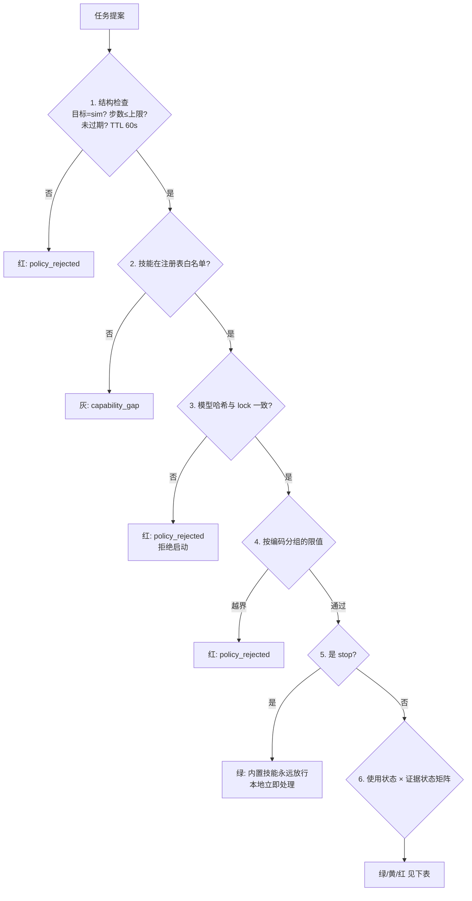

# 网关的规则

> 本文说明 MicroDuck 语言控制中**确定性控制网关**的规则是如何定义、从哪里来、按什么顺序判定的。
> 代码：`language_control/gateway.py`（174 行，纯 Python，无任何 AI 依赖）。
> 背景见 `语言控制MicroDuck原理介绍.md`，操作见 `语言控制MicroDuck方案操作手册.md`。
> 最近更新：2026-11-01（Web v2：check 预检通道、注册表三方消费、技能增至 12 个）。

## 核心原则

语言模型只负责"听懂你说什么"；**能不能执行，只有网关说了算**。网关不相信模型的自律，不从"文件存在、哈希正确"推断"动作会做"，也不允许任何限值跨指令编码通用。

## 一、规则的三份数据来源

网关的规则不是写死在代码里的魔法数，而是来自三份受控数据：

| 来源 | 回答的问题 | 内容 | 能否手改 |
|---|---|---|---|
| 上游官方清单 `reference/policies/v7/manifest.json` + `upstream.lock` | 这个技能**是什么** | 模型文件、SHA-256、指令编码（velocity/phase/posture_flag/constant）、时长、训练溯源 | 不能——改了哈希就对不上 |
| 本地技能配置 `language_control/local_skills.json` | 我们打算**怎么调它** | 技能定义、模型绑定、使用状态、适用范围注记 | 能，但限值必须标注来源 |
| 独立验收记录 `language_control/acceptance_records.json` | 它在什么条件下**被验证过** | 每次真实仿真回放的结果与证据分级（append-only） | 只能由验收流程追加 |

三者由 `scripts/build_skill_registry.py` 组合成 `work/language_control/skill_registry.json`（当前 **12 个技能、12 个模型文件、4 个 available**，三数分列）。

两个纪律：

- **限值溯源**：每条限值都标注来源。例如 walk/walk_backward 的速度限值 vx∈[-0.4, 0.4] m/s 指向训练配置 `velocity_env_cfg.py:113-116`——含义是"策略训练时见过的范围"，超出即分布外；
- **证据不可伪造**：没有任何代码路径能把"哈希正确、形状正确"自动翻译成"验收通过"。证据缺失只能标 `unknown`，生成器只做合并和降级，不做推断。请求 `available` 但证据非 passed 或契约非 verified 的技能，会被生成器**降级为 registered 并告警**（walk_backward 在 2026-11-01 补上真实回放证据后才晋升 available）。

## 二、注册表的三个消费方（同一份数据）

2026-11-01 起，注册表不只是网关的判决依据，还同时驱动：

1. **网关判决**——运行时只读注册表，见下方判定流程；
2. **Kimi 的匹配空间**——Web 端勾选 Kimi 解析时，system prompt 由 `intent.build_system_prompt(registry)` 从注册表实时生成（按文件 mtime 缓存重建）。模型看到的技能清单、中文名、说法、状态标注与技能面板完全一致；新技能注册后自动进入匹配范围，非 available 技能被要求诚实拒答；
3. **Web 技能面板**——`/api/skills` 直接读注册表渲染（usage/evidence/会话可执行性/模型路径/说法列）。

**改一处（三份数据源），三方同时生效**——不存在"面板显示能跑、网关却拦"的两张皮。

## 三、判定流程（`Gateway.check()`，按顺序）

### 预检通道：`op=check`（Web v2 新增）

Web 页面的"网关校验(规则判定)"实时提示走的是 **check 通道**：会话服务对提案执行与正式提交**完全相同**的静态校验（解析+注册表+编码+限值+闭环范围），但**不入队、不写指令文件、不产生 command 账本事件**，只回结论。校验逻辑从 `_submit_steps` 抽出的 `_validate_steps` 单一来源，check 与正式执行永远不会出现判定分叉。停止短语在 Web 层直接短路（`stop_hint`），不进 check。

## 四、按编码分组的限值（关键设计）

同一组参数在不同指令编码下物理含义不同，因此**限值绝不跨编码通用**：

| 编码 | 接受的参数 | 限值规则 |
|---|---|---|
| velocity | vx / vy / yaw / sim_duration_s | 查注册表速度边界（vx∈[-0.4, 0.4]，vy∈[-0.3, 0.3]，yaw∈[-1.0, 1.0]）；walk 另接受闭环 distance_m / turn_deg（范围由闭环控制器限定，越界明确拒绝不降级为开环） |
| posture_flag | **不接受任何参数** | 坐姿/站姿是标志位不是速度，速度限值不适用 |
| phase | 不接受速度/时长参数 | 时长由 period_s × end_phase 决定，不可外部指定 |
| constant | 不接受任何命令字段 | 一次性动作无参数 |
| builtin（stop） | 不接受参数 | 网关内置，无模型 |

## 五、使用状态 × 证据状态矩阵

| usage_state | 含义 | 普通模式 | 显式标志后 |
|---|---|---|---|
| available + passed | 已验证可用（当前：walk、walk_backward、ground_pick） | **绿：放行执行** | — |
| available + failed | 可用但证据失败 | 红：拒绝 | `--research` → 黄：研究回放，标签入账 |
| experimental | 实验性（dance_side_step，证据 failed） | 红：拒绝 | `--experimental`；证据非 passed 还须叠加 `--research`（双重显式确认） |
| registered | 已登记未启用（stand/kick×2/sitdown/standup/roulade/crouch） | 仅 dry-run（构造命令不执行） | `--research` → 研究回放 |
| stop（内置） | 停止 | **永远放行**，不经过 LLM、不排队 | — |

设计要点：**停止权不能被任何状态卡住**；研究回放是唯一的"自举"通道（stand、walk_backward 的核验回放就是走它），但每次都以标签形式留在账本里，可审计。

## 六、判定输出

网关输出不是简单的是/否，而是结构化的 `GateResult`：

- `allowed` / `dry_run_only`：放行与否、是否仅限预演；
- `reason`：人可读的拒绝原因（终端和 Web 直接展示；Web 预检压缩为一行短结论，长原因收悬停提示）；
- `classification`：错误分类——`capability_gap`（机器人缺这个能力）/ `policy_rejected`（能力存在但条件不允许）/ `parse_error`（输出结构非法）/ `provider_error`（API 故障）。**API 故障不会被误记成"缺技能"，JSON 非法也不会被误当成"要训练"**；
- `labels`：研究回放等标签。

每条判定连同命中规则追加进哈希链账本 `work/language_control/events.jsonl`，事后可逐条审计、防篡改。Web 页面的绿/黄/红/灰提示就来自这里。

## 七、一句话总结

**网关的内容 = 上游官方清单（是什么）+ 本地配置（怎么调，限值溯源到训练配置）+ 独立验收记录（验证过什么），由一段纯 Python 判定代码执行：不相信模型的自律，不从文件完整性推断动作能力，不让限值跨编码泄漏，停止权永远在本地；同一份注册表同时喂给网关判决、Kimi 匹配和技能面板，check 预检与正式执行共用同一条校验代码路径。**
