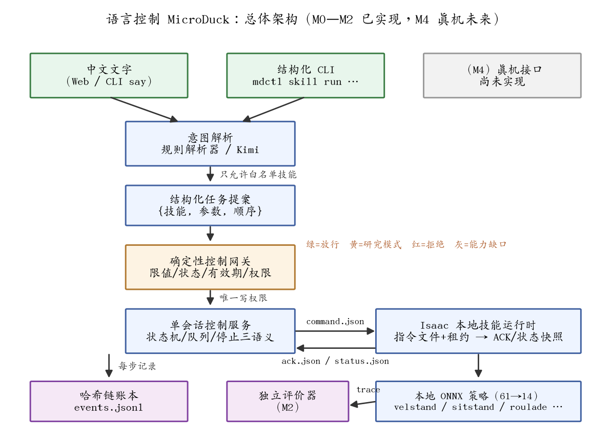
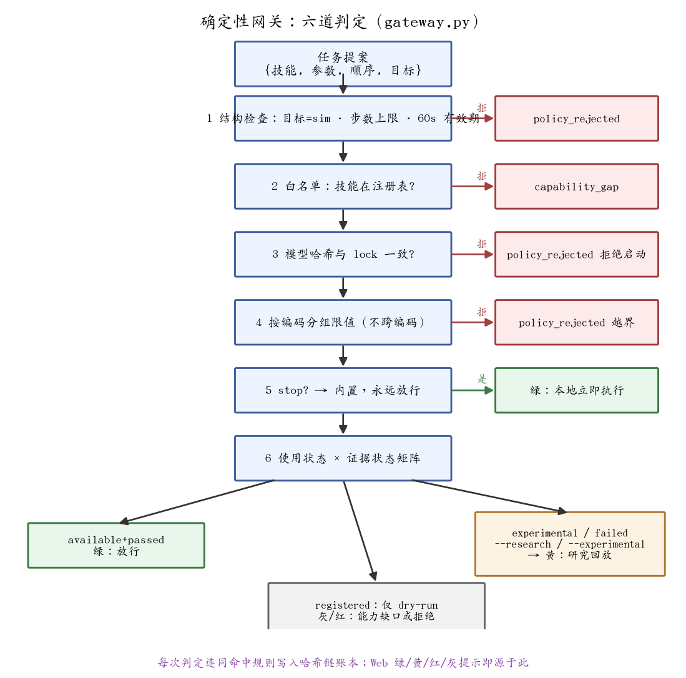
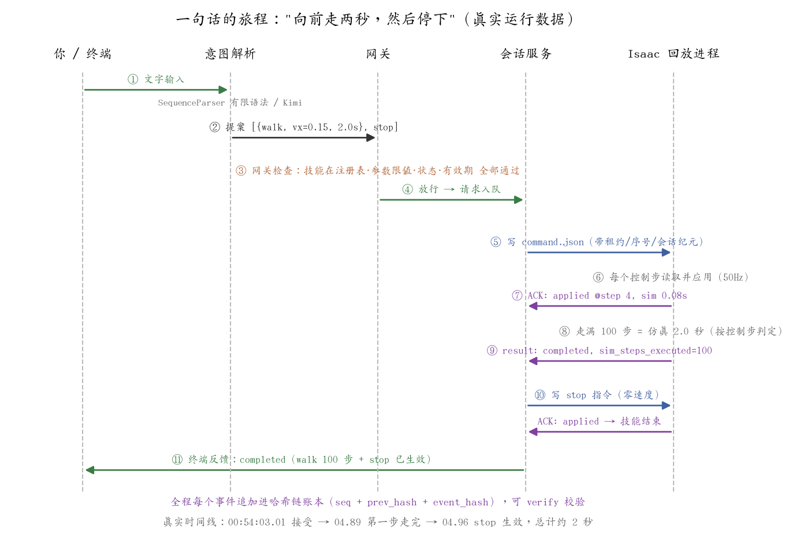
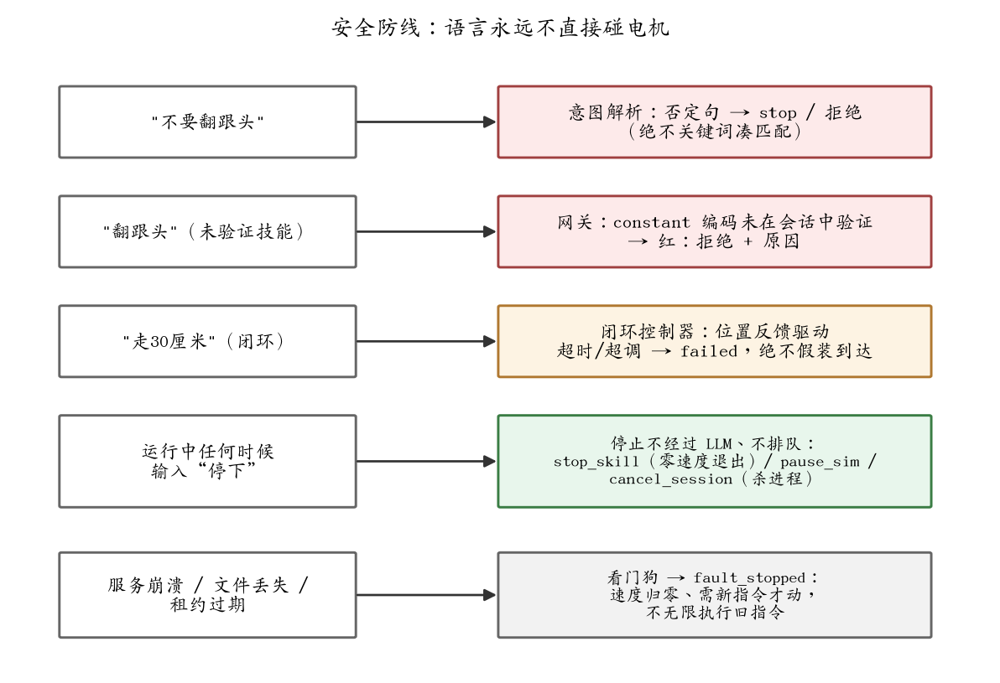

# 语言控制 MicroDuck：原理介绍（M0–M2 + Web v2，M4 真机未来）

> 这份文档回答一个问题：**你说一句中文（或说一句语音），仿真里的鸭子是怎么动起来的？**
> 配套：操作手册 `语言控制MicroDuck方案操作手册.md`（怎么跑命令、怎么排错）、
> Web 使用 `语言控制MicroDuckWeb操作指南.md`、网关细则 `网关的规则.md`、
> 流程图解 `语言控制MicroDuck的方案流程图.md`（四张 mermaid 图拆全链路）。
> 本版更新至 2026-11-01（Web v2：语音、Kimi 接地匹配、check 预检、视频节选）。

## 一句话总览

**语言模型只负责"听懂你说什么"，负责"让电机怎么动"的永远是一组确定性的、可校验的本地程序。**
你的一句话要经过四道关卡才能变成动作：意图解析 → 任务提案 → 控制网关 → 会话服务，最后才到仿真里的策略网络。任何一道关卡不合格，指令都会被明确拒绝并告诉你原因，而不是"猜一个差不多的动作执行"。

## 总体架构



逐层用大白话解释（括号里是代码位置）：

1. **输入层**——四个入口完全等价：中文文字（CLI `say` 或 Web 页面）、**语音**（Web 页面浏览器录音，本地离线转写，见下）、结构化 CLI（`mdctl skill run walk --vx 0.1` 直接给参数，不联网不需要 key）、未来的真机接口（M4，还没做）。
2. **意图解析**（`language_control/intent.py`）——把中文变成结构化数据，两条路径输出格式完全相同：
   - **规则解析器**：有限语法，完整匹配预定义句式（含 20+ 口语同义词、时长/距离/序列修饰），宁可拒也不猜；快、免费、离线；
   - **Kimi 大模型**：自由表述、多步序列（≤8 步）、参数提取（方向/时长/距离/转向）。它的技能清单**不是写死的**——Web 端从活的技能注册表生成 system prompt（`build_system_prompt`），和页面技能面板是同一份数据：新注册的技能自动进入匹配范围，未启用的技能被要求诚实拒答。输出受严格 JSON Schema 约束，且后面还有网关兜底。
   - 两条路都失败时给"你是不是想说：……"建议（difflib 对说法表匹配，只建议不执行）。
3. **任务提案**（`proposal.py`）——一个指令变成一个 JSON：`{技能: walk, 参数: {vx: 0.15, 时长: 2.0秒}}`。多步骤指令变成有序数组，比如"走两秒然后停下"是 `[walk×2s, stop]`。规则或 Kimi 产出，格式与校验完全相同。
4. **确定性控制网关**（`gateway.py`）——整个系统最重要的部件，一段不含任何 AI 的普通代码（174 行）。它检查：技能登记过吗？参数超限吗（速度 ≤0.4 m/s）？技能当前允许执行吗（未验证的只能"研究回放"）？提案过期了吗（60 秒）？**判定只有四种：绿（放行）、黄（研究模式，需显式确认）、红（拒绝+原因）、灰（能力缺口）**。规则完整定义见 `网关的规则.md`。
5. **单会话控制服务**（`session_service.py`）——一个仿真会话只有一个"司机"。排队、按序执行、处理"停下"、续约租约、监控仿真进程健康。**CLI 和 Web 都不能直接碰仿真**，必须通过它——任何时刻都只有一个意志在控制机器人。它还提供一个 **check 预检通道**：与正式提交完全相同的静态校验，但不入队、不发指令——Web 的"网关校验"实时提示走的就是它。
6. **Isaac 技能运行时**（`play_isaac_velocity.py` + `playback_command_feed.py`）——仿真进程每 1/50 秒读一次指令文件、回写确认（ACK）和状态快照。下面详细讲。
7. **本地 ONNX 策略**（`reference/policies/v7/`）——真正的"小脑"：61 维输入、14 维输出的神经网络，每个控制步算出 14 个关节的目标位置。走路的 velstand、坐下的 sitstand、翻跟头的 roulade 都是各自独立的官方策略文件，每个都有 SHA-256 哈希锁定。
8. **哈希链账本**（`work/language_control/events.jsonl`）——每句话、解析结果、网关判定、指令送达确认、执行结果、语音转写记录，全部追加进带哈希链的日志，事后逐条审计、防篡改。

## 技能落位（2026-11-01 注册表实况：12 技能 / 4 可用）

| 技能 | 中文 | 状态 | 会话可执行 | 说明 |
|---|---|---|---|---|
| walk | 行走 | available + **passed** | ✓ | 主策略 velstand，含闭环走距离/转向 |
| walk_backward | 后退 | available + **passed** | ✓ | 2026-11-01 独立成技：vx=-0.15 真实回放核验（位移 -0.119m、done_count=0） |
| ground_pick | 捡东西 | available + passed | ✗ | phase 编码，会话未启用（限 M0 回放 scope） |
| stop | 停止 | 内置 | ✓ | 无模型，本地立即执行 |
| stand | 站立 | registered + **passed** | ✓（零速切换） | 2026-11-01 核验的是 velstand 零速机制；alpha_stand.onnx 本体未单独验 |
| kick_left/right | 左踢/右踢 | registered + passed | ✗ | 证据通过（抬腿标定），但契约 partial（上游无 command 块）+ constant 编码会话未启用 |
| sitdown/standup | 坐下/起立 | registered + pending | ✗ | 评价器区分不了"受控坐下"和"摔倒复位" |
| roulade | 翻跟头 | registered + pending | ✗ | 有真实旋转但回放中发生终止，不得称无重置执行 |
| crouch | 蹲下 | registered + unknown | ✗ | play 脚本缺 action_scale/roller 参数 |
| dance_side_step | 侧步舞 | experimental + **failed** | ✗ | V4 鲁棒性未达标，整改需立项 |

"能听懂但会被拦"和"能执行"是两回事——技能面板把两者都如实显示，不凑数。

## 网关的规则（细则）

网关的规则 = **三份受控数据 + 一段纯判定代码**。三份数据：上游官方清单（技能是什么）、本地技能配置（怎么调）、独立验收记录（验证过什么）；由 `build_skill_registry.py` 合并成注册表。这份注册表有三个消费方：**网关判决、Kimi 的匹配空间、Web 技能面板**——改一处三方同时生效，不存在两张皮。



六道判定：结构检查（sim 目标/步数/60s TTL）→ 白名单（LLM 编不出新技能）→ 哈希校验 → **按编码分组的限值**（velocity 查速度边界；posture_flag 不接受速度参数；phase 时长由契约决定；constant 无参数——限值绝不跨编码泄漏）→ stop 例外（永远放行，停止权不能被任何状态卡住）→ 使用状态×证据状态矩阵（available+passed 放行；registered 只许 dry-run；研究回放是唯一"自举"通道且标签入账）。

完整规则、限值表、矩阵和 check 预检通道见 `网关的规则.md`。

## Web v2：五个增强（2026-10-31/11-01）

1. **实时预检（op=check）**：打字停半秒，会话服务对提案做与正式提交完全相同的静态校验但不执行，页面即时显示"网关校验(规则判定)：✓ 可执行 / ✗ 不可执行(分类)"。长原因收悬停，发送前的最后一道免费问询。
2. **Kimi 接地匹配**：开关一开，Kimi 对着技能面板同一份注册表做技能匹配，自由表述、多步序列、参数都能提取；Kimi 不可用自动回退规则解析。页面显示"匹配结果： walk(vx=0.15,sim_duration_s=2) → stand"供发送前审计。
3. **语音输入**：浏览器 MediaRecorder 录音（不经服务器声卡）→ 上传本机 → ffmpeg 转 16kHz → sherpa-onnx paraformer-zh **离线**转写（不出本机）→ 回显"我听到的是"→ 自动预检 → 你确认点发送才执行。"停下"命中立即停。音频默认即删，转写带模型 SHA-256 入账本。
4. **视频节选**：会话以 `--video` 启动后，整段录像 + **每条命令一个 mp4 片段** + 每秒一帧预览，页面直接看鸭子"正在按命令动"。同名会话重开自动清旧片段。
5. **技能面板**：中文名列、说法列（带方向/速度标注，照着念即可）、usage/evidence 状态、会话可执行性、模型路径——与 Kimi 的匹配空间、网关的白名单是同一份注册表数据。

## 一个真实例子："向前走两秒，然后停下"

下面这张图不是示意图，是 2026-10-29 一次真实运行的数据（你可以在 `work/language_control/events.jsonl` 里逐条核对）：



逐步展开：

**①② 你说"向前走两秒，然后停下"** → 解析器切成两步，生成提案：

```json
{"steps": [
  {"skill": "walk", "params": {"vx": 0.15, "sim_duration_s": 2.0}},
  {"skill": "stop"}
]}
```

**③④ 网关放行**（walk 是已验证技能、0.15 在限值内、提案新鲜）→ 提案变成请求进入会话服务的队列。

**⑤ 会话服务写指令文件** `command.json`。真实内容（已简化）：

```json
{"protocol_version": 1, "session_id": "22432135…", "session_epoch": 1,
 "command_id": "8c33d489…", "sequence": 1,
 "skill_id": "walk", "kind": "velocity_setpoint",
 "params": {"velocity": {"vx": 0.15, "vy": 0.0, "yaw": 0.0}},
 "sim_duration_s": 2.0, "lease_s": 3.0}
```

注意几个字段的用意：`command_id` 防重复执行；`session_epoch` 防止上一个会话的旧指令复活；`lease_s` 是租约——指令只在 3 个仿真秒内有效，写完指令的进程如果崩溃，机器人不会永远执行这条旧指令。

**⑥⑦ 仿真进程每个控制步（50Hz）读指令文件**，校验会话 id 和序号后应用，然后回写 ACK："这条指令我在第 4 个控制步真正用上了"。**服务看到 ACK 才算数**——发了指令但没收到 ACK，绝不当作已执行。

**⑧⑨ 两秒怎么判定？** 按仿真控制步数：2.0 秒 = 100 步。走满 100 步后回放进程写结果 `completed, sim_steps_executed=100`。（这里不用墙钟计时，也不用浮点仿真时间——后者有过 873×0.02−853×0.02 < 0.4 这种浮点误差导致多走一步的真实 bug。）

**⑩ 第一步的结果到手后，服务才写第二步 stop 指令**（速度归零）。序列严格按序，中间任何一步失败，后面的步骤不会执行。

**⑪ 终端收到完成反馈**，包含每一步的执行详情。整条时间线：接受 00:54:03.01 → 第一步走完 04.89 → stop 生效 04.96，全程约 2 秒（这是 Isaac 近实时运行的墙钟时间）。会话以 `--video` 启动时，这两秒同时产出 `clips/0001_*.mp4` 片段，Web 页面可即时回放核对。

## 安全设计：语言永远不直接碰电机



五条防线对应五类真实风险：

- **语义风险**："不要翻跟头"——朴素的关键词匹配会匹配到"翻跟头"然后执行。我们的解析器是完整句式匹配，否定句明确映射为 stop/拒绝；Kimi 路径实测也把"不要翻跟头"解析为 stop。
- **能力风险**："翻跟头"本身合法但 roulade 还没在会话模式里验证过 → 网关红色拒绝并说明原因。未验证的技能**显示但不可执行**，不凑数。
- **目标风险**："走 30 厘米"走闭环控制（见下节），超时或跑偏就如实报 failed，绝不假装到达。
- **停止风险**：任何时候说"停下"，由本地代码直接处理——不经过 Kimi、不排队、不等网络。三级停止语义：stop_skill（技能按验证过的方式退出，仿真继续）、pause_sim（暂停仿真世界）、cancel_session（杀进程并保存证据）。
- **故障风险**：服务崩溃、指令文件丢失、租约过期 → 看门狗触发 fault_stopped：速度归零、必须新指令才能动。**宁可停机，不可失控。**

## "走 30 厘米"：闭环控制是怎么回事

时间指令（"走两秒"）是开环的：给个速度，走够步数就停。距离指令不一样——鸭子实际走得比指令慢（实测指令 0.15 m/s 时真实均速约 0.134 m/s），开环换算会有百分之十几的误差。

闭环的做法：起步时记下起点 p0 和朝向 u0，之后每 50 毫秒读一次位置快照，计算沿目标方向的真实进度 `s(t) = u0·(p(t)−p0)`，到达就停。位置来源明确标注为 `sim_ground_truth`（仿真真值）——真机上没有这种便利，M4 要换成实机定位并重新标定。实测：目标 0.3 米，终点误差 0.0077 米。

同时约束横向漂移、航向偏移和超时——任一超限立即中止并报 failed。"左转 30 度"同理，用相对航向反馈而不是"角速度×时间"。

## 怎么判断"真的做到了"：评价器（M2）

进程正常退出 ≠ 动作做对了。`evaluator.py` 按技能家族分别判定，结论分四级：`passed` / `process_only`（进程对但动作证据不足）/ `failed` / `insufficient_data`：

| 家族 | 看什么证据 |
|---|---|
| velocity（走/后退） | 实际速度 vs 指令、位移方向、横向漂移、没倒地；零指令时测站立保持 |
| phase（蹲下/捡） | 相位完整推进、关节有真实动作（方差足够大，排除"站着不动但相位在走"） |
| posture（坐/站） | 起止高度、变化方向、终态稳定、不是趴倒 |
| constant（翻跟头/踢球） | 翻跟头要有真实旋转圈数（≥0.5 圈）、踢球要抬对腿 |

而且**标定样本和验收样本分开**——不能用同一条轨迹既定阈值又证明通过。单次通过只记 `sim_smoke_passed`，不泛化成"任意环境可用"。

## 当前边界（如实，2026-11-01）

- 会话内"走→停→走"连续执行已验证；**站定后再发新指令，velstand 在这个 Isaac 配置下会锁死站立**（站立不动吸引子），起步/原地转向都无效——策略层面的限制，已确认存在、尚未解决；
- sitdown/standup/roulade 保持 pending（评价器区分不了"受控坐下"和"摔倒后复位"）；
- kick 双通过但契约 partial（上游 manifest 无 command 块），且 constant 编码在持久会话中不可用；
- ground_pick 的 phase 编码、跨模型热切换（walk→sitdown）同样保持"未验证"，网关明确拒绝；
- crouch 因 play 脚本缺 action_scale/roller 参数未启用；alpha_walking.onnx、roller.onnx 两个模型从未注册技能；
- Kimi 路径需要 Moonshot key（页面可配，内存-only）；Web 仍是本地原型，不宣传为生产安全方案。

## M4 真机展望（未实现）

架构上 M4 只是多加一个"真机适配器"，但前置条件是硬性的：

1. 每个要上真机的技能先完成真机验证（当前舞蹈从未上过真机）；
2. 真机的本地控制器始终保留实时控制、互锁和急停——语言层和 LLM 永远不进安全回路；
3. 位置来源从 `sim_ground_truth` 换成实机定位（里程计/动捕），全部重新标定；
4. 账本沿用——真机上"谁下了什么命令、网关放没放行、执行结果如何"会比仿真更重要。

## 自己动手

最小体验（stub 后端，不需要 GPU）：

```bash
cd ~/microduck-ros2-isaac
PY=work/dance/microduck_rl/.venv/bin/python
$PY -m language_control.mdctl session start --backend stub --name demo
$PY -m language_control.mdctl say --session demo "向前走两秒，然后停下" --execute --wait-result
$PY -m language_control.mdctl say --session demo "不要翻跟头"     # 看否定句处理
$PY -m language_control.mdctl say --session demo "给我飞起来"     # 看能力缺口拒绝
$PY -m language_control.mdctl session stop --name demo
```

Web 完整体验（真实仿真 + 画面 + 语音）：

```bash
$PY -m language_control.mdctl session start --backend isaac --name demo --video
$PY -m language_control.web --port 8787   # 浏览器打开终端打印的带 token URL
```

页面上：打字或点"2.语音"说话 → 看"网关校验"与"匹配结果" → 点"3.发送并规则解析"执行 → 在"仿真画面"里看鸭子每步的视频片段。完整说明见 `语言控制MicroDuckWeb操作指南.md`。
