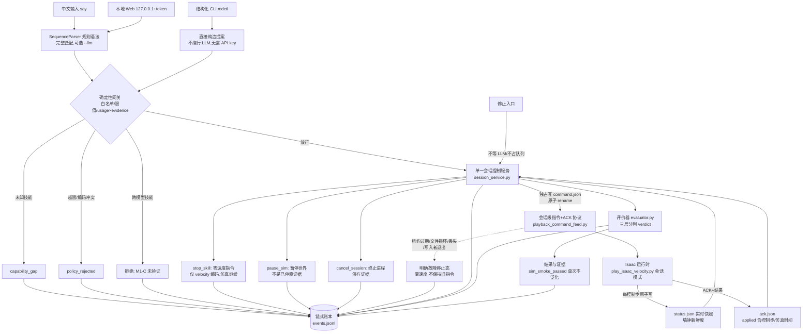

# 语言控制 MicroDuck 方案操作手册（M1+M2）

> 版本：M1-A/M1-B/M1-C + M2 + Web（2026-10-27）。M0 版见 `语言控制MicroDuck方案操作手册_v1.md`。
> 原理科普（一句话如何变成仿真动作，配真实数据与图）见 `语言控制MicroDuck原理介绍.md`。
> 范围：持久仿真会话、结构化 CLI、中文序列、停止三语义、技能评价器、本地 Web 薄客户端。零训练、不接真机。
> 对应代码：`scripts/playback_command_feed.py`、`scripts/sim_stub_playback.py`、`scripts/play_isaac_velocity.py`（会话模式）、`language_control/{session_service,mdctl,evaluator,web,intent,proposal,gateway,ledger_log}.py`。

三条红线（形状兼容≠语义兼容；导入≠获准；dry-run≠动作成功）继续有效，M1/M2 新增一条操作纪律：**被网关放行 ≠ 动作成功**（运行状态、契约检查、动作质量三层分列）。

## M1+M2 全流程图

## 会话级指令与 ACK 协议（§3.1 落实）

`command.json`（服务独占写，原子 rename）字段：`protocol_version` / `session_id`+`session_epoch` / `command_id` / `sequence` / `skill_id` / `contract_version`（=sha256:策略哈希）/ `kind`（velocity_setpoint|stop_skill|pause_sim|resume_sim|cancel_session）/ `encoding` / 互斥 typed params / `coordinate_frame` / `units`（仅 m/s+rad/s）/ `sim_duration_s` / `lease_s` / `issued_at`。

- **拒绝**：NaN/Inf、未知字段、编码冲突（encoding 与 params 块不一致、多个 typed 块并存）、无效类型、错误 session/epoch、乱序/过期 sequence；
- **去重/续约**：同 command_id+sequence 重读为 no-op；同 command_id 更高 sequence 为租约续约——**不重启一次性命令、不重置完成计时**；
- **有限命令**按仿真时间从 applied ACK 起算，完成自动回零；**租约过期 / 文件丢失 / 文件损坏 / 写入者退出（mtime 看门狗）→ 明确故障停止态**（run_state=fault_stopped，速度归零，恢复须新的有效请求）；
- **ACK**：accepted/applied/rejected；applied 含实际控制步与仿真时间；results 记录 completed / interrupted_by_reset / stopped；
- **reset**：episode 边界（20s time_out）由播放端检测 dones 并记录 episode_id/reset_reason，活动命令显式中断（interrupted_by_reset），序列默认中止；不静默继续；
- **实时快照**：`status.json` 每控制步原子更新（applied_command_id、policy hash、sim_step、sim_time、episode_id、run_state、根位姿/速度、done_count、reset_reason、wall_updated_at）；快照不新鲜不得当作停止证据。

## 停止三语义

| 语义 | 行为 | 证据口径 |
|---|---|---|
| `stop_skill` | velocity 编码零指令（该编码专属，不推广到 phase/constant/posture_flag） | 仿真继续；需另查新鲜度+速度+高度才称"已停稳" |
| `pause_sim` | 暂停仿真世界 | 兜底，不是机器人已稳定停止的证据 |
| `cancel_session` | 终止仿真进程，保存证据 | 不宣称完成了动作退出 |

任何停止不等 LLM、不占任务队列；停止使未生效旧任务失效，包括停止前构造、停止后才到达的请求（按 created_at 判定丢弃）。

## 实现过程详细步骤

### M1-A（会话服务+协议+CLI）

1. 新增 `scripts/playback_command_feed.py`：协议解析/校验、CommandFeed 状态机（去重/续约/租约/看门狗/完成/中断）、ACK 与快照原子写。无 Isaac 依赖。
2. `scripts/play_isaac_velocity.py` 新增 `--command-file/--status-file/--ack-file/--session-id/--session-epoch/--command-watchdog-s`；**缺席时固定命令路径逐字节不变**（见下方 M0 对照：全指标 abs_diff=0）；会话模式只留薄调用。
3. 新增 `language_control/session_service.py`：单会话服务进程，独占 command.json 写权限；请求/响应目录协议；序列引擎（下一步等上一步 ACK+结果，失败即中止后续）；租约续约与写者心跳；故障监控；停止三语义。
4. 新增 `language_control/mdctl.py`：`session start/stop`、`skills list`、`skill run`、`say`、`skill stop`、`status`。结构化 CLI 无需 API key。
5. `language_control/ledger_log.py` 事件类型扩展：session/command/ack/sequence/fault。
6. 验证：`tests/test_playback_command_feed.py` 26 例、`tests/test_session_service.py` 16 例，全部无 Isaac（替身 `scripts/sim_stub_playback.py` 复用真实 feed 状态机）。

### M1-B（中文入口+序列+真实仿真验证）

1. `language_control/intent.py` 新增 `SequenceParser`：连接词切分（然后/接着/之后/随后/再）、秒级时长后缀（向前走两秒/走0.5秒）、否定/条件/距离仍拒绝；M0 单步 `IntentParser` 行为不变。
2. `proposal.py`/`gateway.py` 增加 `max_steps`（默认 1，M0 行为不变；会话服务用 8）。
3. 语义等价：CLI 与中文共用 `_resolve_step`+网关，测试忽略 command_id/sequence/时间戳后逐字段一致。
4. **真实 Isaac 验证**（headless，后台）：
   - 跨 20s 边界会话（v2，hold-start 修复后，会话 m1b20v2）：命令从 step 0 应用，真实行走满 1000 步（fwd 0.532m），在 **sim 20.0s 被 time_out reset 显式中断**（interrupted_by_reset，episode_id=1，done_count=1，reset 后速度归零、无静默继续）。产物 `work/language_control/sessions/m1b20v2/`。（v1 m1b20 协议语义同样正确但当时踩中站立不动吸引子，机器人未真实行走——以 v2 为准。）
   - M0 固定命令对照：不带 `--command-file` 同参重跑 M0-B walk（vx=0.15, 100 步, seed 42），与基线 `executions/ccbba025…/playback.json` 按固定容差对比——**所有指标 abs_diff=0（逐位一致）**。报告 `work/language_control/m1_m0_compare/comparison.json`。

### move_distance 闭环（§3.6，真实 Isaac 验收）

1. 新增 `language_control/closed_loop.py`（无 Isaac 纯逻辑）：`DistanceController`（固定 p0/u0，进度 s(t)=u0·(p(t)-p0)，横向误差/航向漂移/仿真超时约束，位置来源标注 `sim_ground_truth`）与 `TurnController`（相对航向反馈，wrap_angle 处理角度环绕）。服务每 50ms 读状态快照驱动控制器，命令变化超阈值才覆写（减振），进度每秒入账。
2. 意图解析接入：`走30厘米`/`向前走0.5米`/`走三百毫米` → distance_m；`左转30度`/`右转四十五度` → turn_deg；超闭环范围（0.05–1.0m / ±5–180°）明确拒绝，**不静默替换为开环估算**。
3. mdctl：`skill run walk --distance-m 0.3` / `--turn-deg 30`。
4. **真实 Isaac 验收**（会话 m1cl5，首命令 hold-at-start）：move_distance 0.3m → **done，终点误差 0.0077m，横向 0.025m，航向漂移 -2.4°，3.32 sim-s**。
5. 中途降速段（0.15→0.05 m/s）实测会让 velstand 失速进入站立不动吸引子 → 改为全程巡航、到达即停，终点误差如实报告。
6. **原地转向未验证**：yaw=0.8 持续 10 sim-s 步态活跃（action_max 0.67）但航向几乎不变（-1.1°）——velstand 在本 Isaac 配置下原地转向无效；`TurnController` 逻辑有单测与 stub 闭环覆盖，结论如实标注。
7. 单测 15 例（收敛、横向/航向/超时故障、角度环绕、stub 会话闭环、越界拒绝）。

### M1-C（转换边）

- 注册表新增 `transition_edges`（local_skills.json 声明，`build_skill_registry.py` 透传并富化 A/B 模型哈希）。
- `walk->stand`：`same_policy_param_switch`，**verified_same_policy**（共用 velstand.onnx；证据：序列/停止测试 + m1b20 真实会话零指令与 cancel 路径）。按任务书 §3.5 修正口径：这不是跨模型切换。
- `walk->sitdown`：cross_model，**保持 unverified**（无合格转换边不凑数；会话服务对跨模型技能一律拒绝，测试锁定）。

### M2（评价器）

1. 新增 `language_control/evaluator.py`：三层分列（run_state/contract/motion），verdict ∈ passed/process_only/failed/insufficient_data；单次通过记 `sim_smoke_passed`；done_count 细分（物理终止/时间截断/人工 reset/取消/进程异常/unknown）；time_out 不算跌倒但不得称无重置连续执行。
2. 四家族动作证据：velocity（方向/速度比 0.5–1.3/横向漂移/未倒地）；phase（展开相位覆盖度，允许模 1 回绕记录周期；关节方差>1e-3 证明有真实动作）；posture_flag（方向正确+末段稳定+非趴倒）；constant（roulade 真实旋转圈数≥0.5，kick 抬腿证据）。
3. 阈值按 M0-B 实测标定（站立根高 ~0.117m、地板 0.005m、vx=0.15 实测 0.134 m/s、ground_pick 关节方差 0.30）。
4. `tests/test_evaluator.py` 12 例：真实正例（walk、ground_pick 重评 passed/sim_smoke_passed）+ 合成反例（原地相位推进、倒地静止、过期 telemetry、仅末帧站立无翻滚、相位跨界展开、reset 拼接不计连续执行）。
5. 验收记录追加 2 条（walk、ground_pick 的 M2 重评），注册表重建。

### M2 核验回放（2026-10-27，真实 Isaac ×5，串行 headless）

| 技能 | 命令 | 评价器判定 | 结论 |
|---|---|---|---|
| sitdown | sit=1.0, 100 步 | **failed**（stable_terminal 1.05e-3 超标：高度 0.116→0.06 下行触地 done_count=1 后回 0.117——trace 末段含 reset 拼接） | 保持 **pending**；与标定样本 bed740ad 逐位一致，仍无法区分受控坐下与倒地+复位 |
| standup | stand=0.0, 100 步 | **failed**（direction：从站立出发 0.116→0.117，不构成起立动作） | 保持 **pending**；真实起立验证需从坐姿出发（M1-C 之后） |
| roulade | 零指令, 50 步 | **process_only**（真实旋转 0.762 圈 ✓，但 done_count=4，不得称无重置连续执行） | evidence unknown→**pending**，不升级 |
| kick_left | 零指令, 25 步 | **passed**（左脚峰值 0.0247m > 阈值 0.017=1.5×步态标定 0.0111，右脚 0.0015m 未抬） | **sim_smoke_passed**，契约 partial 故保持 registered |
| kick_right | 零指令, 25 步 | **passed**（右脚 0.0291m，左脚 0.0098m） | 同上 |

标定/验收样本分离：kick 阈值标定于 M0-B walk 步态轨迹，验收用新跑回放。产物 `work/language_control/m2_verification/`。

### Web（薄客户端）

1. 新增 `language_control/web.py`：stdlib http.server、仅 127.0.0.1、会话 token（启动时打印）、请求体上限 64KB；单页内嵌 HTML/JS：中文输入框、技能面板（usage/evidence 着色）、执行进度、动作结果、历史列表、独立停止按钮。
2. 复用 session_service 请求/响应文件协议，**不建第二套执行器**；`/api/stop` 独立路径不解析不排队；`/api/status` 只读文件不阻塞。
3. `tests/test_web.py` 8 例（urllib 打本地服务 + stub 会话）：token 强制、413 上限、status/skills、say 序列闭环、运行中停止可达（<5s）、history。

### 本次修复记录（实施期发现）

1. **完成判定浮点 off-by-one**：feed 原按 `sim_time - applied >= duration` 判定，改为按控制步数判定，消除 dt 累积误差。
2. **stub 过快导致租约假过期**：全速替身仿真时间远超墙钟，服务 50ms 续约循环追不上 3s 仿真租约 → 误判 lease_expired。修法：`streaming_lease_s` 成为服务参数（快仿真测试用大租约，真实 Isaac 近实时用默认 3s）；另有 stub 测试进程跑完 steps 预算提前退出造成的 flaky，以超大 steps 预算消除。
3. **velstand 站立不动吸引子（真实 Isaac 重要发现）**：会话中若在仿真已走若干步后才下达首个运动指令，velstand 会锁定在站立不动吸引子（obs 命令槽确为 0.15 但关节始终不摆动，action_max 0.249 vs 行走 0.584，五轮确定性复现）；命令从第 0 步起在则正常行走（M0-B 及手动对照均验证）。修法：会话模式新增 **hold-at-start**——播放端在 step 0 停等首条命令（`waiting_first_command` 状态，可被 cancel 打断，180s 墙钟超时退出），保证首个运动指令从第 0 步生效。**已知限制：velstand 在本 Isaac 配置下不能从已稳定的站立平衡再次起步**（站立→行走切换冻结），行走→站立→再行走的会话内重启未验证；walk→stand（减速停车）可用。
4. **资产根坐标系 π 偏移**：root_quat_w (wxyz) 在 spawn 时读数 yaw=π 而机体朝 +x 行走（M0-B 前向位移为证）。闭环控制的航向读数统一 +π（`closed_loop.YAW_OFFSET_RAD`），相对量不受影响。
5. **mdctl session start 陈旧文件竞态**：上一会话遗留的 requests/*.json（如 cancel）被新 daemon 立即消费导致启动即自杀；修法：start 时清理陈旧协议文件 + daemon 拒绝早于本进程启动时间的请求文件。
6. **Vulkan ICD 路径**：/etc/vulkan/icd.d 为空，nvidia_icd.json 实际在 /usr/share/vulkan/icd.d；minimal_env 两个路径都找。

### 用户实测修复（2026-10-28/29，commit 17b05a2 / 6b72bca / 668efcc）

7. **已退出会话挂死 → 快速失败**：会话进程退出（如步数预算耗尽）后，`skill run/say/stop` 原先挂死到超时；现在立即报错并提示重启，等待中途会话死亡也会即时返回。新增死会话快速失败回归测试。
8. **默认步数预算过小**：`session start` 默认 `--steps 1500`——全速 stub 约 1 秒耗尽，Isaac 近实时也只有 30 仿真秒，用户还未下第一条指令会话就已退出。默认改为 2,000,000 步。**注意：`--steps` 是整个会话生命周期的总预算（含待机），不是单条指令的预算；不要显式传小值。**
9. **stub 闭环租约假过期（用户路径）**：修复 2 只覆盖了测试参数化，`mdctl` 实际启动路径未带大租约，用户跑"走30厘米"在 stub 上必然 lease_expired。修法：stub 后端默认 `streaming_lease_s=3600`（仿真秒），Isaac 保持 3s，可用 `--streaming-lease-s` 覆盖；写者活性仍由墙钟看门狗守护。提醒：stub 上闭环精度无意义（控制延迟在仿真时间里被放大，曾超调至 1.08m），运动精度以 Isaac 为准。
10. **闭环失败不写终态响应（最严重）**：`_drive_closed_loop` 在调用 `_fail_active_and_queue` 之前先清空了 `_active`，失败归属丢失，`--wait-result` 永远等不到响应（用户"走30厘米"踩中吸引子后闭环 8 仿真秒超时，账本已记 timeout 但终端无输出）。修法：失败分支保留 `_active` 再失败。附 `sim_stub_playback.py --freeze` 测试钩（指令已应用但机体不动，模拟吸引子）+ 冻结超时必返回 failed 的回归测试。
11. **用户实测确认吸引子真实存在**（修复 3 的后续）：序列内"走→停→走"连续执行正常（位置实移 0.18m），但站定后独立的下一条运动指令锁死站立（进度 0.0037m 超时）。"站立→再行走"从"未验证"降级为**确认无效**，策略层面问题，需立项处理。

### M2 Web v2 增强（2026-10-31：实时校验 + 语音 + 视频节选）

1. **`op=check` 只校验不执行**：session_service 抽出 `_validate_steps`（_submit_steps 与 check 共用，单一事实源），check 复用完整静态校验（解析+注册表+编码+限值+闭环）但不入队、不写 command.json；账本记 `sequence event="check"`。
2. **Web 实时可执行反馈**：`POST /api/check`，输入框 500ms 防抖自动校验，绿（可执行）/黄红（逐条原因）/灰（会话未起）。
3. **会话录像**：`mdctl session start --backend isaac --video` → 整段 session.mp4 + **每命令片段** clips/（新模块 `scripts/session_clip_recorder.py`，按 applied_command_id 边界开关 ffmpeg 管道；<12 帧的闭环 supersede 碎片自动删；编码器故障只丢片段不打死仿真）+ 1Hz latest.jpg 预览帧（PIL）。Web 新增 /api/clips、/api/clip（basename 防穿越）、/api/frame.jpg，页面"仿真画面"面板 1Hz 预览 + 片段点播。修复 hold-at-start 早退不收尾 video 的边界。
4. **语音输入**：浏览器 MediaRecorder 收音（不做服务器端声卡采集），`POST /api/voice` 收 webm/opus（≤8MB，超限先排空再 413 防断管）→ ffmpeg 转 16k WAV → sherpa-onnx paraformer-zh 离线转写 → 回显 + 自动 check → 用户点发送才执行；"停下"命中立即停。账本 `asr` 事件（时长/转写/模型 SHA-256），音频默认删（--keep-audio 留存）。
5. 测试：check 4 例（绿/限值拒/能力缺口拒/暂停拒 + 零执行痕迹）、web check+clips+voice 6 例、ClipRecorder 3 例（真 ffmpeg + 合成帧，libx264）、asr 3 例（合成/样本 WAV，不碰声卡）。回归 226 passed + 2 env-gated skip + 85 subtests。

### Web v2 使用规则（2026-11-01，用户实测后补充）

6. **会话自动选择 + 切换栏**：`GET /api/sessions` 按 mtime 列出全部会话；页面 URL 不带 `session=` 时自动连最新 running/paused 会话（此前默认死连 `sim01`，用户实测踩坑：盯着已取消的旧会话报"无预览帧/session is cancelled"）。顶部"会话"栏可手动切换并显示实时状态，不用改 URL。
7. **片段面板只展示本次会话**：`session start` 清理陈旧协议文件时，同名旧会话的 `session.mp4`、`latest.jpg(.tmp)`、`clips/*.mp4` 一并删除（回归测试 `test_start_clears_stale_video_artifacts` 锁定）。**要留存的片段必须在重开同名会话前复制走**。`/api/clips` 返回片段目录绝对路径，面板顶部显示，悬停片段可见完整路径。
8. 输入框加高（3em→7em）。完整使用说明单独立文：`docs/语言控制MicroDuckWeb操作指南.md`（语音方案文档第三节已互链）。

## 技能落位终表（M1+M2 后）

| 技能 | 模型(hash 前8) | 编码 | usage | evidence | 会话可执行 | 备注 |
|---|---|---|---|---|---|---|
| walk | velstand ce894d30 | velocity | available | passed（M0-B + M2 重评 sim_smoke_passed） | ✓ | M1 会话主策略 |
| stand | alpha_stand 15692687 | velocity(zero) | registered | unknown | ✓（同策略零指令切换，落 velstand） | 修正：非跨模型 |
| ground_pick | alpha_ground_pick ffbf5109 | phase(4.0×0.7) | available | passed（M0-B + M2 重评） | ✗（phase 编码会话未启用） | M0-B scope 限定 |
| sitdown/standup | alpha_sitstand a6f102d9 | posture_flag | registered | pending | ✗ | M2 核验：sitdown 末段含 reset 拼接；standup 从站立出发不构成起立 |
| roulade | roulade 3d60da08 | constant | registered | pending | ✗ | M2 核验：真实旋转 0.762 圈但 done_count=4 → process_only |
| kick_left/right | ball_kick_* | constant | registered | **passed**（sim_smoke_passed） | ✗ | M2 核验：指定腿 0.0247/0.0291m，阈值标定于步态样本；契约 partial 不升级 |
| crouch | roller_crouch a1a084be | phase(5.0×0.7) | registered | unknown | ✗ | action_scale 接口缺口 |
| dance_side_step | V4 2e7709f1 | phase | experimental | **failed** | ✗ | 结论不因此轮改动 |
| stop | 无 | builtin | available | unknown | ✓ | 本地即时 |

转换边表：`walk->stand`（same_policy_param_switch / verified_same_policy）；`walk->sitdown`（cross_model / **unverified**，服务拒绝）。

## 分级验收结论

- **M1-A 通过**：无 LLM 全功能（stub 端到端 + 真实 Isaac 会话）；命令失效可控（租约/看门狗/丢失/损坏→故障停止态，26+16 例无 Isaac 测试）；无静默 reset（真实跨 20s 验证 v2：真实行走满 1000 步后显式 interrupted_by_reset）。
- **M1-B 通过**：中文=CLI 语义等价（忽略 id/时间戳逐字段一致）；序列有序不丢步、失败不续跑；真实 Isaac 会话回放完成（hold-start 修复站立不动吸引子后机器人真实行走）。
- **M1-C 部分**：同策略边已验证；跨模型边无合格候选，**保持未验证**（不凑数）。
- **M2 通过（限仿真范围）**：四家族评价器 + 正例重评 + 6 类反例；五家族核验回放：kick 双通过（sim_smoke_passed），sitdown/standup/roulade 如实保持 pending；单次通过一律 sim_smoke_passed。
- **§3.6 move_distance 通过（限仿真）**：0.3m 终点误差 0.0077m；原地转向未验证（如实标注）。
- **Web 通过（本地原型）**：三入口同服务；停止独立可达；不宣传为生产安全方案。
- 回归：全套 unittest discover **218 例**（M0 时 141），仅既有 `test_dance_slope_terrain` import error + 2 个 env-gated skip。

## 已知缺口

- ~~Kimi 端点未实测~~ **已实测（2026-10-28）**：默认模型从已下线的 `kimi-k2-0905-preview` 改为 `kimi-k3`（可用 `KIMI_LC_MODEL` 覆盖）；kimi-k3 仅接受 temperature=1，客户端 400 时自动降级（`KIMI_LC_TEMPERATURE` 可覆盖）。实测结果：**strict JSON Schema 支持=是**；"翻跟头"→roulade、"不要翻跟头"→stop（否定正确）、"先蹲下再站起来"→capability_gap（两技能均 registered，不放行不猜测）、"给我跳个舞"→dance_side_step（网关仍按 experimental+failed 拦截执行）。长句偶发 20s 超时（REQUEST_TIMEOUT_S，可按需调大）。密钥仅经环境变量传入，不落盘、不入账、不进子进程。
- **velstand 站立不动吸引子**：本 Isaac 配置下不能从已稳定站立平衡起步/原地转向；会话内"站立→再行走"经用户实测**确认无效**（修复记录 11）；move_distance 仅限首命令从 step 0 起步的会话。
- vy/yaw 纯横向/转向命令的航向证据需 trace 支持（当前保守降级 insufficient_data）。
- M1-C 真实跨模型切换、M3 真机边界：另立项。
- dance V4 保持 experimental+failed，整改需另行立项。

## 明确不做（边界复核）

真机/ros2_ws；ASR；训练与训练作业层；不改 v7 manifest/upstream.lock；M0 固定命令路径行为不变（已逐位对照验证）；Web 不宣传生产安全；不 git commit。
