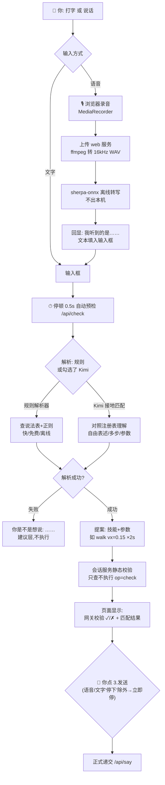
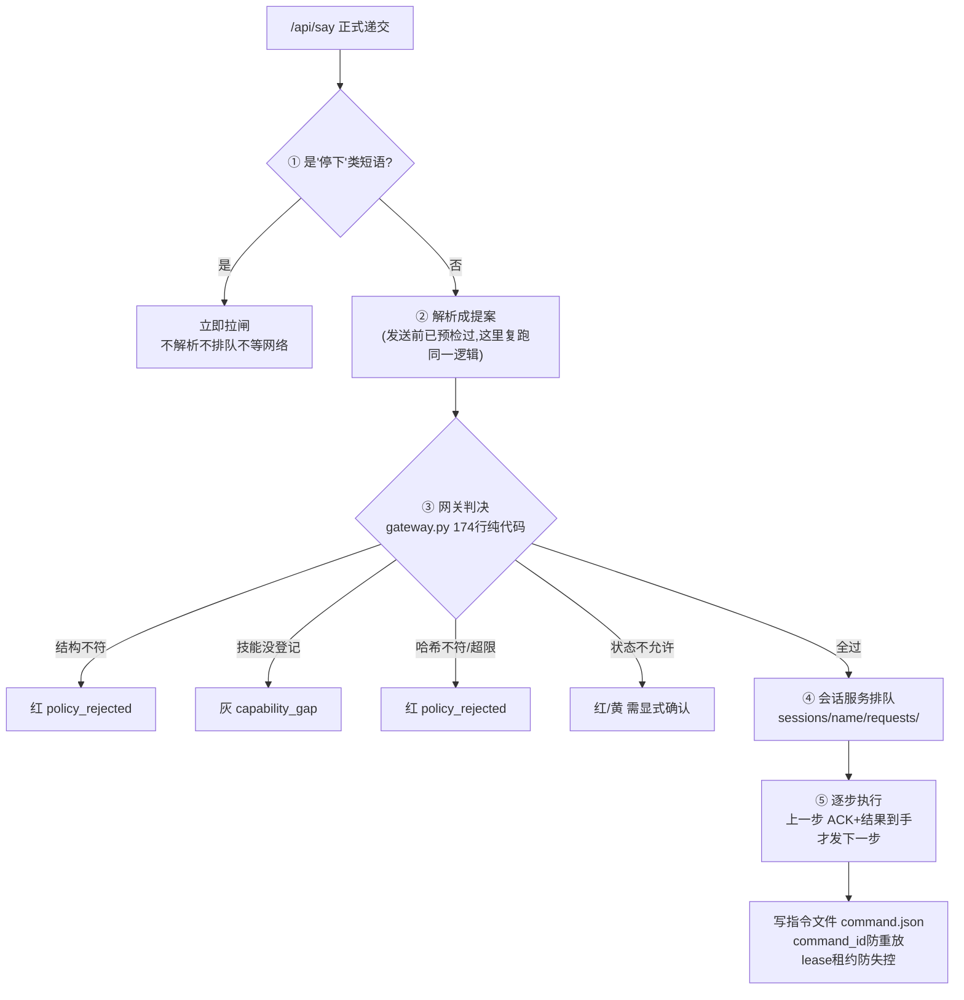
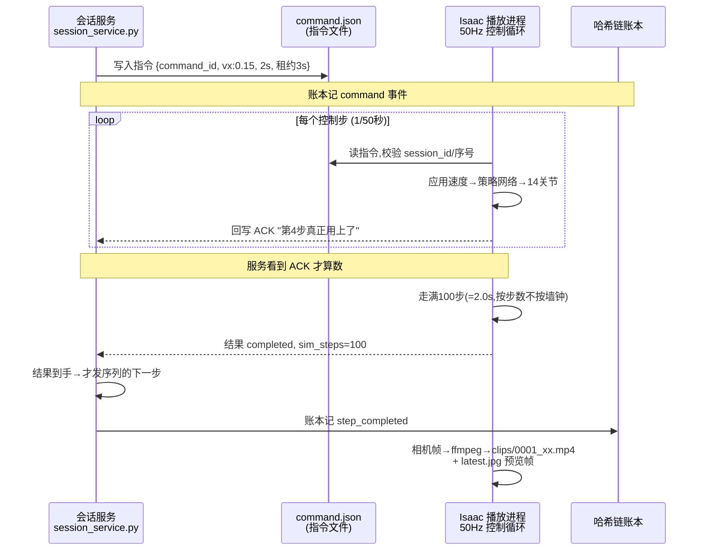
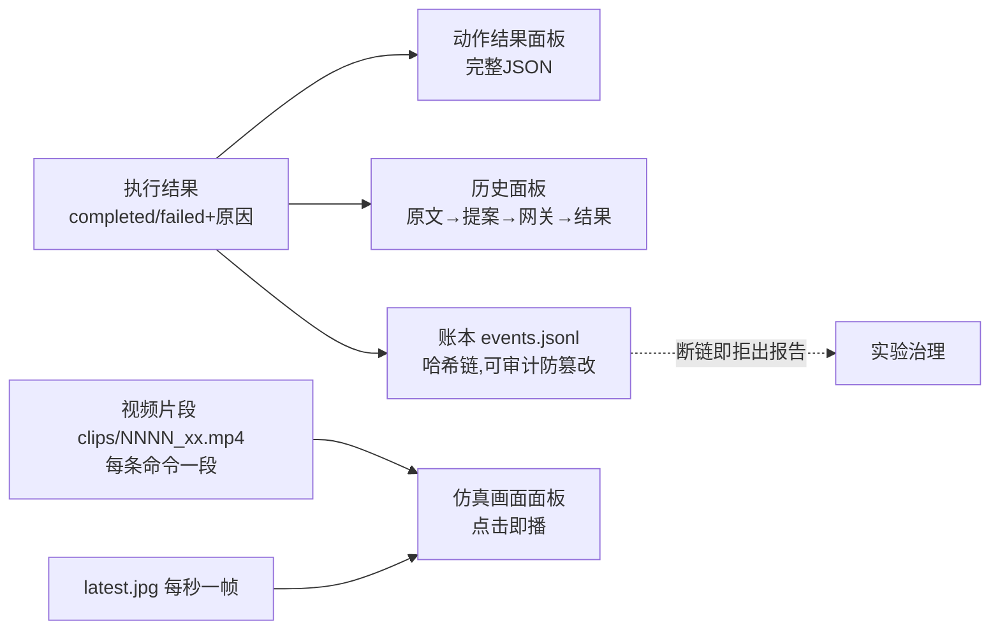

# 语言控制 MicroDuck：方案流程图

> 日期：2026-11-01。四张流程图 + 关键设计点，拆解"从语言/文字到最终结果"的完整链路。
> 配套：原理介绍 `语言控制MicroDuck原理介绍.md`、网关细则 `网关的规则.md`、
> 操作手册 `语言控制MicroDuck方案操作手册.md`、Web 使用 `语言控制MicroDuckWeb操作指南.md`。

## 图 1 · 全景：一句话的完整旅程

## 图 2 · 点发送之后：五道关卡

## 图 3 · 仿真侧时序：50Hz 的握手（以"向前走两秒"为例）

## 图 4 · 结果怎么回到你眼里

## 关键设计点（容易忽略的几件事）

1. **语音和文字在进入解析前就已经合体**——ASR 只负责把声音变文字，之后走完全相同的流水线，不存在"语音专用通道"，少一条路径少一类 bug
2. **预检和正式发送用的是同一段校验代码**（`_validate_steps`）——你看到的 ✓/✗ 和发送后的判决不会分叉
3. **Kimi 只在第②步**——它的工作到"产出提案"为止；第③步网关是纯代码，不认识 Kimi，也不给 Kimi 面子
4. **"发了指令"≠"执行了"**——必须收到播放进程的 ACK 才认账；租约到期没续约，鸭子自动停
5. **两秒是数出来的，不是等出来的**——按 50Hz 控制步数（2s=100步），不用墙钟也不用浮点仿真时间（那个浮点误差 bug 真实咬过人）
6. **失败会截断序列**——"走→转身→站住"如果转身那步被拒，"站住"不会执行，不会留下不可预测的状态
7. **每条命令一段视频**——你想核对"刚才那步走成什么样"，不用拖整段录像，直接点对应片段
